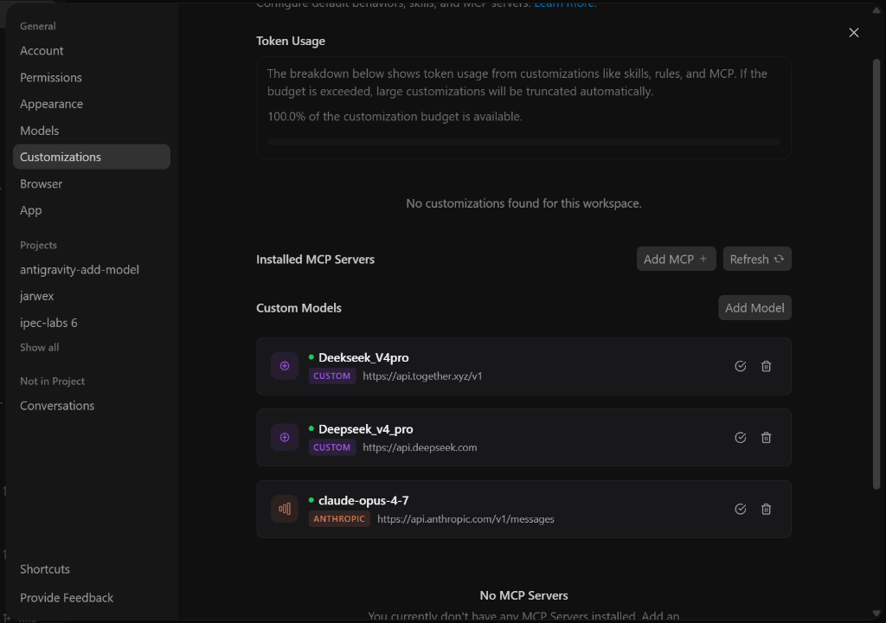
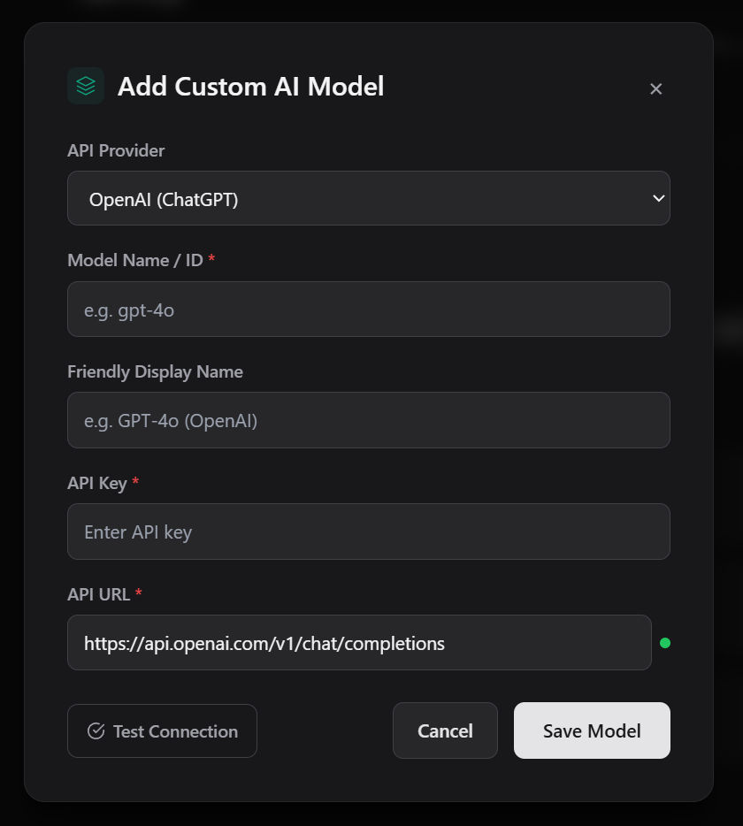
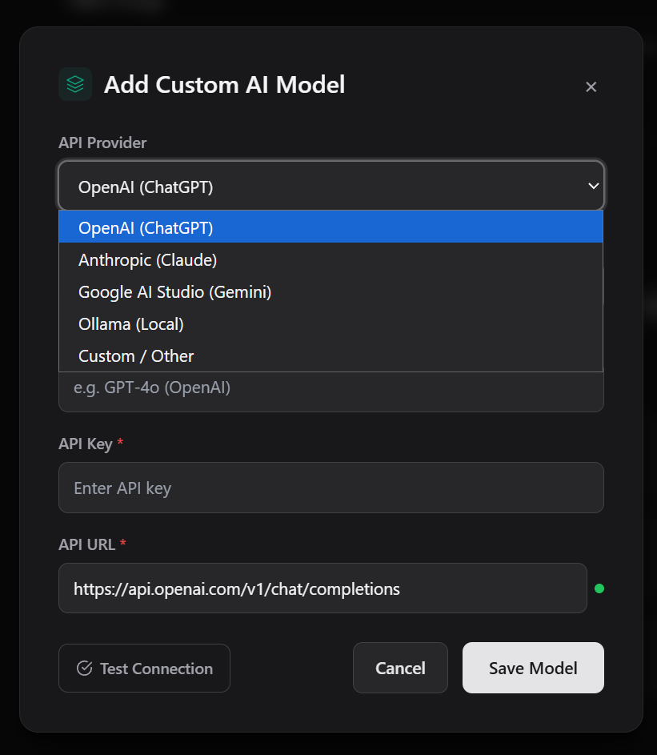
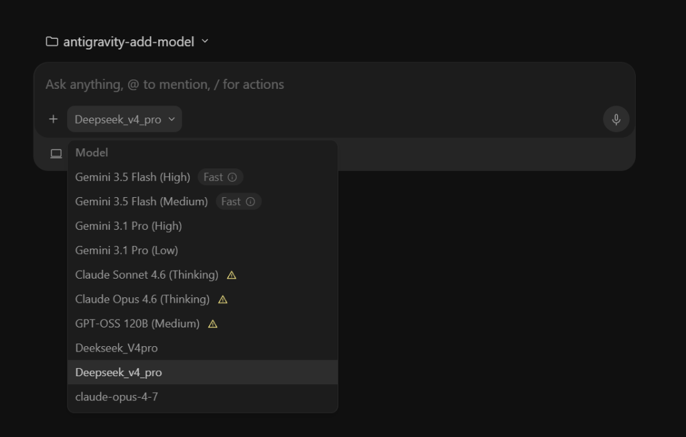
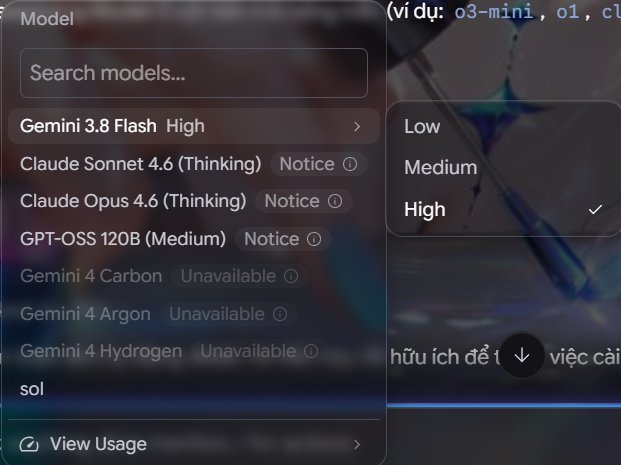

# Custom Your Antigravity

<p align="center">
  <strong>The Ultimate Customization Mod for Google Antigravity Desktop (Windows)</strong><br>
  Combines <strong>Custom Themes & Wallpapers</strong> with a native <strong>Custom AI Providers & Models Manager</strong> in a single, reversible installer.
</p>

<p align="center">
  <a href="https://github.com/khanhlop11/custom-your-antigravity"></a>
  
  
  
</p>

---

## 📸 Screenshots & Demos

### Custom Models Management & Native Chat Integration
<p align="center">
  
</p>

<p align="center">
  
  
</p>

<p align="center">
  
  
</p>

---

## 🌟 Key Features

### 1. 🎨 Custom Themes & Wallpaper Engine
- **Local Wallpaper Engine**: Set custom background wallpapers offline via the local protocol `agy-theme://wallpaper/<filename>` (`PNG`, `JPG`, `WebP`, `GIF`, `BMP` up to 25 MB).
- **Independent Glassmorphism & Opacity Controls**:
  - Background Dim & Gaussian Blur sliders.
  - Left Sidebar opacity & glass blur.
  - Prompt Composer (input area) opacity & glass blur.
  - Right Side Panel / Swarm board opacity & glass blur.
- **8 Chat Bubble Presets**: `Default`, `Charcoal Cat`, `Galaxy`, `Scroll`, `Jade Dragon`, `Moon Witch`, `Fox`, and `Frost Glass`.
- **4 Prompt Input Presets**: `Frosted Glass`, `Neon Glow`, `Floating Pill`, and `Minimal Flat`.
- **Live Settings Integration**: Access the **Custom Theme** tab directly inside Antigravity's **Settings** menu. Appearance updates take effect in real time without restarting the application.

### 2. 🤖 Custom AI Providers & Model Management
- **Third-Party Provider Support**: Add OpenAI, Anthropic (Claude), Ollama (Local), DeepSeek, OpenRouter, Google Account Pools, Cloudflare Workers AI, and custom OpenAI-compatible endpoints.
- **⚡ Automatic Reasoning Level Detection & Submenus**: Automatically scans provider reasoning metadata (e.g. OpenRouter `reasoning.supported_efforts`, OpenAI o1/o3-mini, DeepSeek-R1). Directly integrates into Antigravity's native flyout submenus with all effort levels:
  - **Low**
  - **Medium**
  - **High**
  - **Extra** (`xhigh`)
  - **Max** (`max`)
- **Native Model Picker Integration**: Switch between custom and built-in models seamlessly directly from the chat interface.
- **Full Multi-Agent & Swarm Support (`/swarm`)**: Delegate and assign tasks to custom models across autonomous agent workers.
- **Smart "Update Now" Flow**: When adding or removing models, a prominent **🔄 Update now** banner and button appear so you can choose when to restart Antigravity without disrupting active agent tasks.

### 3. 🛡️ 100% Safe & Reversible
- Automatically creates SHA-256 verified backups of original core files before patching.
- Restore the original official Google Antigravity build byte-for-byte at any time with a single command.

---

## 🚀 Quick Start (Installation)

### Prerequisites:
- **Antigravity Desktop** installed on Windows (`%LOCALAPPDATA%\Programs\antigravity`).
- **Node.js** (v22 or newer).
- **PowerShell** (Windows 10/11 default).

### Installation Steps:

1. Open PowerShell and clone the repository:
   ```powershell
   git clone https://github.com/khanhlop11/custom-your-antigravity.git
   cd custom-your-antigravity
   ```
   *(Alternatively, click **Code -> Download ZIP** on GitHub, extract the folder, and open PowerShell inside it).*

2. Run the installer:
   ```powershell
   powershell -ExecutionPolicy Bypass -File .\install.ps1
   ```

The script will automatically:
- Close any active Antigravity background processes.
- Install required dependencies automatically if missing.
- Backup the pristine application archive.
- Apply the integrated Theme and Model Provider modifications.

3. Launch **Antigravity** and enjoy your customized workspace!

---

## 📖 How to Use

### 1. Customizing Themes & Wallpapers
1. Open Antigravity and go to **Settings** (`Ctrl+,` or click the gear icon).
2. Select **Custom Theme** in the left sidebar.
3. **Upload Wallpapers**: Click **Upload Wallpaper** or drag & drop images into the dropzone.
4. **Adjust Glassmorphism**: Use the sliders to customize opacity, blur, and dim levels to your liking.
5. **Choose Presets**: Click on any of the chat bubble or input presets to apply them immediately.

### 2. Adding Custom AI Models
1. In **Settings**, navigate to **Custom Models**.
2. Click **Add Model** and choose your provider (e.g., OpenAI, Claude, Ollama, OpenRouter).
3. Fill in your **API Key**, **Base URL**, and **Model ID**, then click **Save**.
4. For reasoning models, the mod automatically configures the flyout submenu with **Low**, **Medium**, **High**, **Extra**, and **Max** levels in the chat dropdown.
5. Click the purple **🔄 Update now** button on the toolbar or notification banner to reload Antigravity and make your new model available in the chat dropdown and for `/swarm`.

---

## 🔄 Uninstallation (Restore to Factory Settings)

To completely remove the mod and restore Antigravity to Google's official original state:

```powershell
powershell -ExecutionPolicy Bypass -File .\uninstall.ps1
```

---

## 👤 Author & License

Developed and maintained by **[khanhlop11](https://github.com/khanhlop11)**.  
Released under the [Apache-2.0 License](LICENSE).
